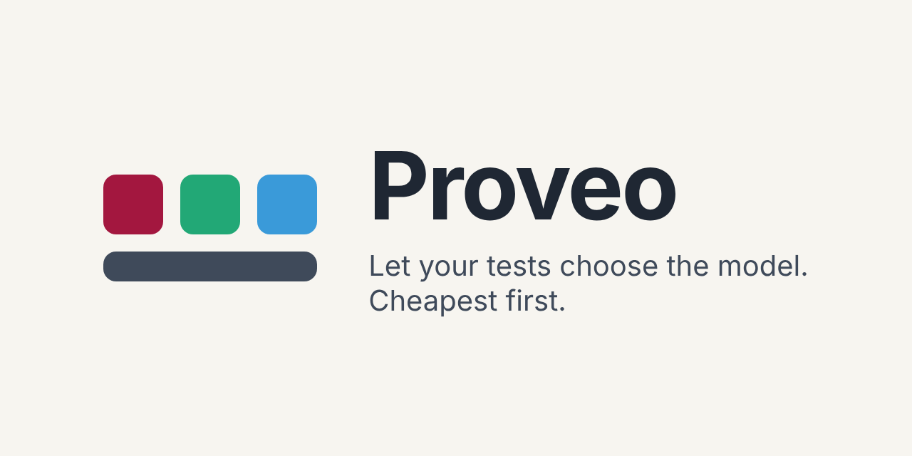

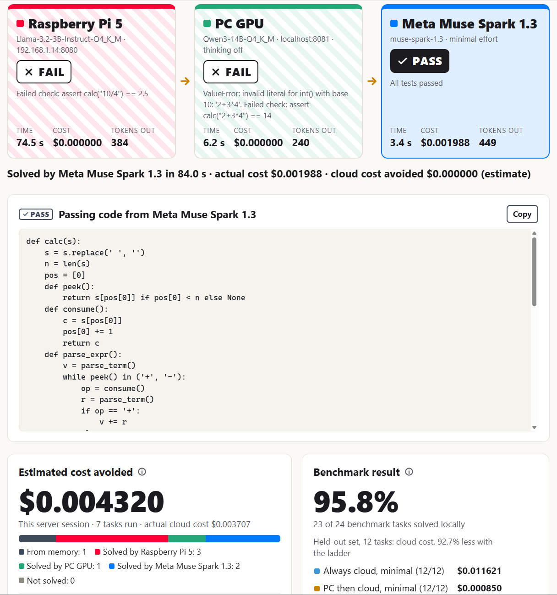

*A code task going up a three-rung ladder. The Raspberry Pi 5 fails after 74.5 s and the PC GPU after 6.2 s, both at $0.000000. Meta Muse Spark 1.3 at minimal effort passes in 3.4 s for an actual cost of $0.001988.*

## What it does

Proveo is a Windows desktop app that gives a coding task to the cheapest model you have and runs the answer against your tests. If the answer fails, the next model up the ladder gets the task. The first answer that passes wins, and no rung after it is called, so a paid cloud model is only used when the cheaper ones could not pass. It only works for tasks that have tests.

## See it work

### The task behind the image above

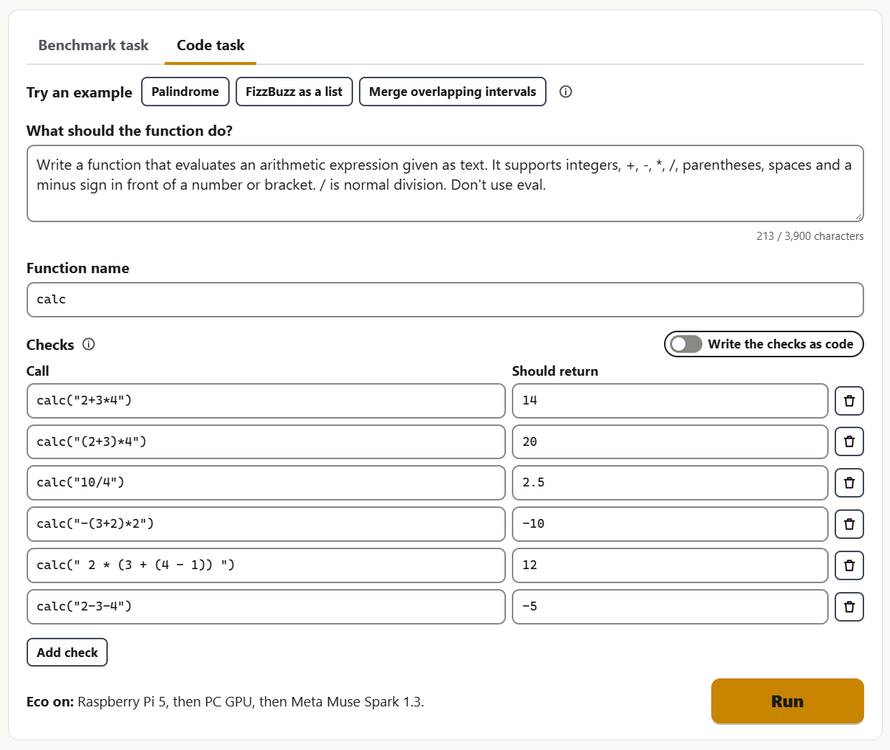

*The Code task form for that run: a description, the function name `calc`, and six checks written as a table.*

### A local rung passes at no cost

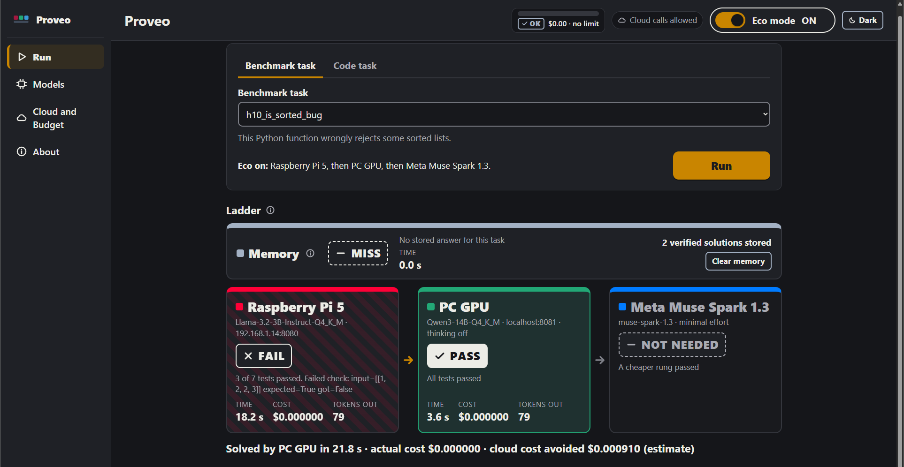

*Benchmark task `h10_is_sorted_bug`. The Raspberry Pi 5 passes only 3 of 7 tests, so it fails. The PC GPU passes in 3.6 s. The cloud rung is not needed. Actual cost $0.000000, estimated cloud cost avoided $0.000910.*

### A repeat run is answered from memory

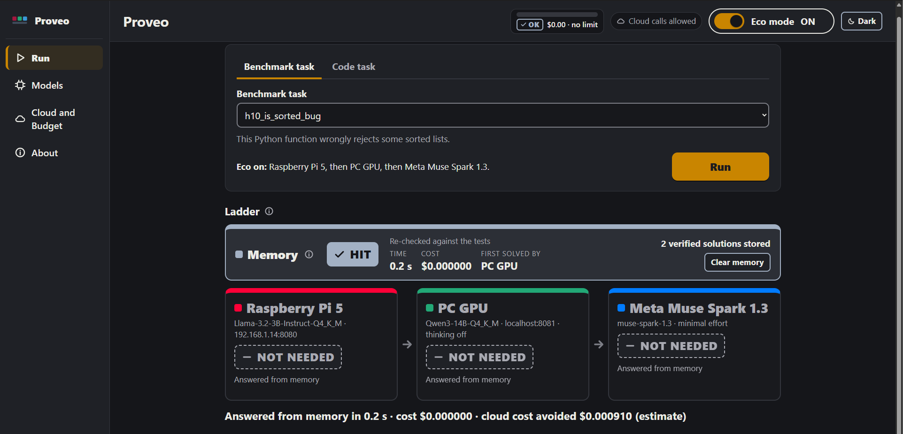

*The same task again. The stored answer, first solved by the PC GPU, is re-checked against the tests and passes in 0.2 s. No model is called.*

### A failing check, shown on the page

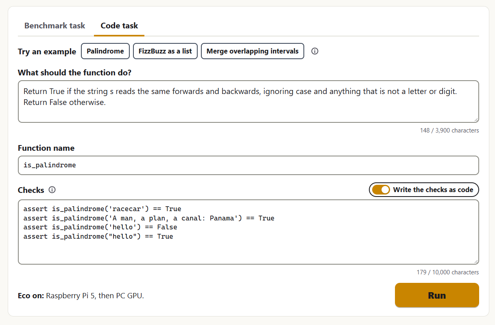

*A task with checks written as code. The last check, `is_palindrome("hello") == True`, contradicts the one before it, so no answer can pass.*

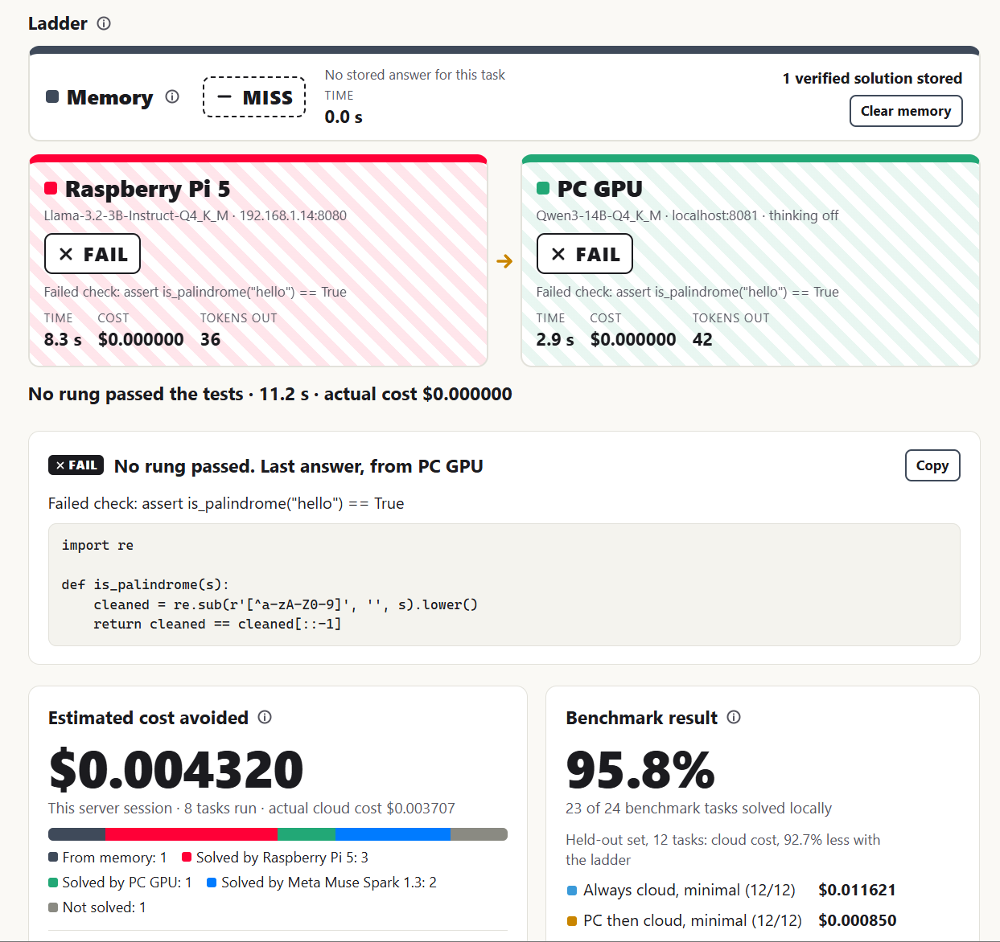

*Both rungs fail, and each card names the check that failed. Proveo reports "No rung passed" and shows the last answer. The failed check stays on the page and is not written to the log.*

### Eco mode off, straight to the cloud

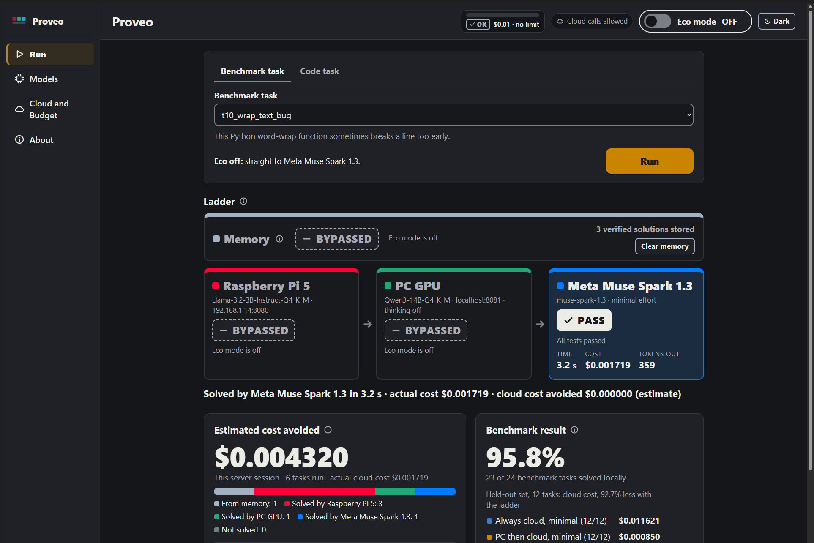

*With the Eco mode switch off, memory and the local rungs are bypassed. Benchmark task `t10_wrap_text_bug` goes to Meta Muse Spark 1.3: 3.2 s, actual cost $0.001719. This is a different task from the local run above, so the two costs show how the modes behave. They are not a measured saving.*

### Budget and keys

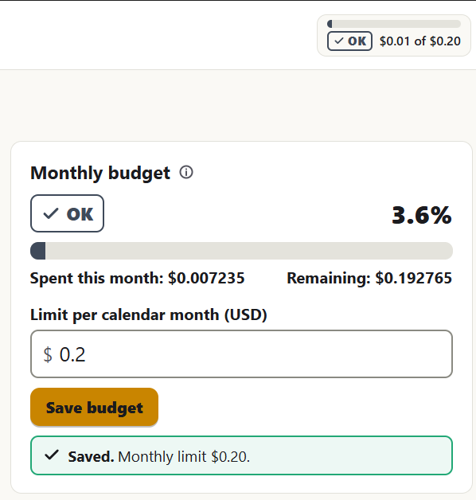

*A monthly limit of $0.20, with $0.007235 spent this calendar month (3.6%) and status OK.*

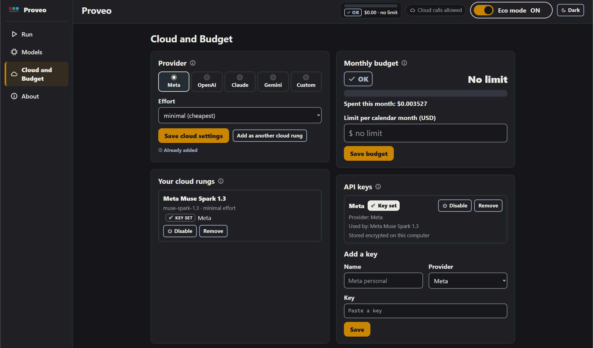

*The Cloud and Budget screen: provider choice, your cloud rungs, the monthly budget (no limit set here) and API keys. The Meta key shows who uses it and that it is stored encrypted on this computer.*

### Models and server status

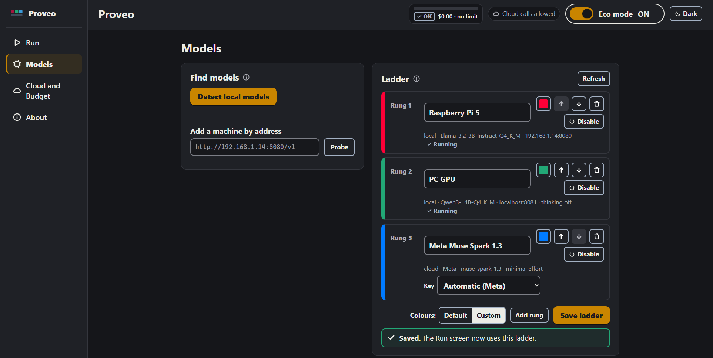

*The ladder on the Models screen. Both local servers show Running, which means the server answered. It does not confirm that the rung's model is loaded.*

### Light mode

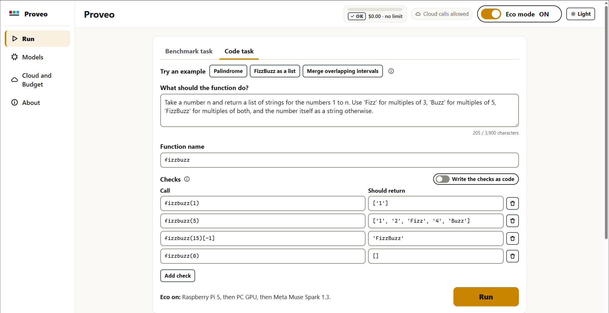

*The Code task form with the FizzBuzz example.*

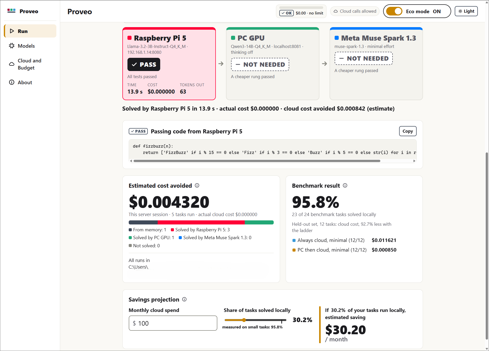

*The Raspberry Pi 5 passes in 13.9 s at $0.000000. Below it, the measured benchmark result (23 of 24 small benchmark tasks solved locally) and the savings projection. The projection's $30.20 a month is an estimate for a chosen 30.2% local share of a $100 monthly spend.*

## Install

1. Download `Proveo Setup 0.1.0.exe` from the [GitHub Releases page](https://github.com/MooreHaww/proveo/releases). GitHub shows the file name with dots (`Proveo.Setup.0.1.0.exe`), and it is the same installer.
2. Run it. The installer is unsigned, so Windows SmartScreen warns about it. Choose **More info**, then **Run anyway**.

- It installs per user, with no administrator rights, to `%LOCALAPPDATA%\Programs\proveo-desktop`, and creates a desktop shortcut.
- To uninstall, use Windows Settings. Your data stays in `%APPDATA%\Proveo`.

## Quick start

1. Start a local model server on this computer or another machine on your network. Any server with an OpenAI-compatible address works.
2. Make sure it is running.
3. Open Models and press Detect local models. It checks this computer only, for Ollama (port 11434), LM Studio (port 1234) and llama.cpp (ports 8080 and 8081). It does not scan your network. For another machine or port, enter its address under Add a machine by address and press Probe. Then press Add as rung on the models you want.
4. Put your rungs in order, cheapest first, and press Save ladder.
5. Optional: in Cloud and Budget, add a cloud rung, store a key and set a monthly limit. Cloud stays off until a key is stored.
6. On Run, pick a benchmark task or write a Code task with your own checks. Proveo stops at the cheapest rung that passes.

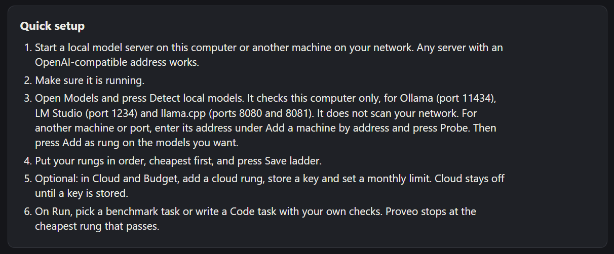

*The same six steps, in the Quick setup box on the About page.*

## How it works

- **Ladder:** your rungs run in the order you set, and the task stops at the first answer that passes.
- **Your tests:** a benchmark task brings its own tests. A Code task uses your checks, as a table or as code. The tests decide, not the model.
- **Verified memory:** an exact repeat of a task reuses a stored answer, and that answer is checked against the tests again every time.
- **Budget guard:** spend is added up from this app's own log for the calendar month, using the prices set on each rung. You get a warning from 80% of your limit, and at 100% cloud rungs are skipped. It does not see your provider's account.
- **Keys:** in the desktop app they are stored encrypted on this computer. A key goes only to the rung that names it, or to the default Meta rung if it is your only Meta key.
- **Cloud off by default:** cloud rungs are not called until a key is stored.

## Results

Scope: small single-function coding tasks, each run once on each tier. There are 24 tasks: two development sets of 6 and a held-out set of 12. The held-out set has now been used for this comparison, so any further tuning needs a new, unseen task set.

Models: Pi = Llama 3.2 3B Q4_K_M, PC = Qwen3 14B Q4_K_M, cloud = Muse Spark 1.3.

**Measured on these 24 tasks:** 23 solved locally (95.8%). The PC failed only one (`h04_group_anagrams`), so only 1 of 24 tasks reached the cloud. The savings below come almost entirely from the PC tier.


*Which tier passed each of the 24 tasks. Each tier ran each task once.*

### Cost on the held-out set

12 tasks, one run each. The table comes from `simulate_router.py`, which works out each strategy from the saved per-tier results. Costs and seconds are from those measured runs. The ladders in the table were not run live as one sequence. The baseline for the saving is always-cloud at minimal effort.

| Strategy | Solved | Cost USD | Seconds | Saving vs always-cloud minimal |
|---|---|---|---|---|
| Always cloud (high) | 11/12 | 0.047228 | 75.6 | |
| Always cloud (minimal) | 12/12 | 0.011621 | 25.1 | |
| Pi only | 8/12 | 0.000000 | 213.1 | |
| PC only | 11/12 | 0.000000 | 39.4 | |
| PC -> cloud (minimal) | 12/12 | 0.000850 | 41.3 | 92.7% |
| Pi -> PC -> cloud (minimal) | 12/12 | 0.000850 | 229.0 | 92.7% |

On these 12 tasks, PC -> cloud (minimal) solved all 12 for $0.000850, compared with $0.011621 for always-cloud at minimal effort. Going through the Pi first gave the same cost and took longer.


*Cloud cost per strategy on the 12 held-out tasks, from one run.*

### Measured and estimated in the app

The app labels these values:

- **Actual cost:** what a run cost, worked out from its token counts and the prices set on each rung.
- **Benchmark result:** the measured numbers above.
- **Estimated cost avoided:** what the cloud would probably have charged for tasks solved locally. It is an estimate.
- **Savings projection:** an estimate that scales that up. It ignores electricity and hardware.

### Energy

From `energy_report.py`, on the 12 held-out tasks, in a separate benchmark run with power logging, one run. Energy is measured above idle, and electricity is priced at $0.15 per kWh. The Pi -> PC row is an estimate.


*Energy above idle per solved task, and total benchmark time. PC energy is GPU only and Pi energy is board rails, so the two are not measured the same way.*

| | Solved | Benchmark s | Wh | Wh per solved task | Electricity USD |
|---|---|---|---|---|---|
| PC | 11/12 | 39.3 | 0.80476 | 0.07316 | 0.00012071 |
| Pi | 8/12 | 184.5 | 0.19814 | 0.02477 | 0.00002972 |
| Pi -> PC (estimate) | 11/12 | 198.5 | 0.48482 | 0.04407 | 0.00007272 |

Cloud at minimal effort for the same 12 tasks cost $0.011621.

Limits of the energy numbers:

- **PC energy is GPU only**, read from nvidia-smi. **Pi energy is the board power rails**, read from vcgencmd.
- **Cloud energy is not published**, so no energy comparison with the cloud is made.
- **Idle values:** PC idle is the mean of a separate idle log (37.45 W). Pi idle is a constant 1.88 W, the mean of six manual readings.
- **Sample intervals are nominal** (PC 0.5 s, Pi 1.0 s). The PC timestamps actually average 0.509 s apart.
- **The power logs run longer than the benchmarks:** the PC log covers 62.0 s and the Pi log 300.0 s, against 39.3 s and 184.5 s of tasks. Energy above idle outside the tasks is included.
- **The Pi -> PC row is an estimate:** it splits the PC's energy across tasks in proportion to each task's seconds.

## Honest limits

- It only works for tasks that have tests. The tests choose the model, but Proveo cannot judge answers that have no tests, and weak tests let a wrong answer pass.
- The code check runs in a separate process with a time limit, closed stdin and an environment without your API key. It also rejects answers that contain a short list of blocked imports and calls. It is not a real sandbox, and the code a model writes runs on your computer.
- The benchmark tasks are small, and each was run once.
- Local model answers vary between runs. In the author's runs, the Pi 5's answers varied.
- Savings are estimates unless labelled actual.
- Only the Meta Muse Spark provider was tested with a real key. The OpenAI, Claude and Gemini presets are untested against the real services.
- Windows only so far.
- The installer is unsigned. SmartScreen has not been tried on a fresh machine.
- Detect checks this computer only (Ollama 11434, LM Studio 1234, llama.cpp 8080 and 8081). Other machines are added by address.
- A force-kill in the first seconds of a first run can lose a newly saved key. The app then says so.

## For developers

All commands are PowerShell, run from the repository root unless they say otherwise. Some source files and the Eco mode switch keep the name "eco" from an earlier name of the project.

### Run from source

```powershell
git clone https://github.com/MooreHaww/proveo.git
cd proveo
python -m venv .venv
.venv\Scripts\Activate.ps1
pip install requests
```

Run Proveo in its own window. It uses the Python in `.venv`:

```powershell
cd desktop
npm install
npm start
```

Or run the local server and open its page in a browser. A task run here writes to `results/`:

```powershell
python eco_server.py --port 8765
```

`--log` and `--memory` on `eco_server.py` change where its log and verified memory go. Cloud stays off in this server unless `ALLOW_CLOUD=1` is set when it starts.

### Where data lives

The two setups keep separate budgets.

| | Command line (`eco_server.py`, `eco.py`) | Desktop app |
|---|---|---|
| Log | `results/eco_log.jsonl` | `<profile>\eco\eco_log.jsonl` |
| Verified memory | `results/eco_memory.jsonl` | `<profile>\eco\eco_memory.jsonl` |
| Settings | `user_data/settings.json` | `<profile>\eco\settings.json` |
| Keys | memory only | `<profile>\model-key.enc`, encrypted |

The installed app's profile is `%APPDATA%\Proveo`. A profile from an earlier install in `%APPDATA%\Eco` moves there once, if the new folder does not exist yet. `npm start` uses `%APPDATA%\pi-edge-router-desktop`.

### Tests

The test suites use fake servers and make no real model or cloud calls.

```powershell
python -m unittest discover -p "test_*.py"
```

```powershell
cd desktop
npm test
```

The packaging tests that need the bundled backend skip until `build/proveo-backend` exists.

### Build the installer

This builds the backend with PyInstaller in its own virtualenv under `build/`, then writes `desktop\dist\Proveo Setup <version>.exe`. The result needs neither Python nor this folder.

```powershell
cd desktop
npm run dist
```

The build bundles an explicit list of result CSVs. It never bundles the log, the verified memory, `router_log.csv` or `cloud_calls.csv`.

The installer is not code-signed. On "Windows protected your PC", choose **More info**, check the file is the one you built, then **Run anyway**. Antivirus tools may also flag or slow an unsigned app, in which case restore the file or allow that one file; turn nothing off.

### The command line tool

`eco.py` lists local servers and runs one benchmark task up the original Pi, PC and cloud ladder. It checks verified memory first and writes to `results/`. The cloud rung is off unless `ALLOW_CLOUD=1` is set in the same window.

```powershell
python eco.py discover
python eco.py solve data/coding_tasks_heldout.py h10_is_sorted_bug
```

### Benchmarks

The Pi runs Llama 3.2 3B Q4_K_M through llama.cpp's server. Its address is `LOCAL_URL` in `router.py` and can change after a reboot. Start the server with a small context, because without `-c 4096` it is killed for running out of memory:

```bash
./build/bin/llama-server -m ~/models/Llama-3.2-3B-Instruct-Q4_K_M.gguf -c 4096 --host 0.0.0.0 --port 8080
```

The PC backend expects a llama.cpp server at `http://localhost:8081` (`PC_URL` in `bench_coding.py`). The PC tier runs Qwen3 14B (Q4_K_M) on an RTX 5070 (12 GB) through llama.cpp (build b11913, CUDA), started with:

```powershell
.\llama-server.exe -m Qwen3-14B-Q4_K_M.gguf -c 4096 -ngl 99 --port 8081
```

The benchmark sends `chat_template_kwargs` with `enable_thinking` set to false, so Qwen3 skips its thinking phase.

Run a benchmark on a task file. Backends are `pi`, `pc` or `cloud`. Task files are `data/coding_tasks_dev.py`, `data/coding_tasks_dev2.py`, `data/coding_tasks_heldout.py` and `data/energy_heldout.py`.

```powershell
python bench_coding.py pi data/coding_tasks_heldout.py
```

Results are written to `results/coding_<backend>_<task file>.csv`. For the cloud backend the file name also includes the effort, for example `results/coding_cloud_minimal_coding_tasks_heldout.csv`.

The cloud backend is off unless two switches are set in the same PowerShell window. Cloud calls cost money.

- `ALLOW_CLOUD=1` turns cloud calls on.
- `BENCH_EFFORT` chooses the reasoning effort, `minimal` or `high`. The default is `minimal`, from `CLOUD_EFFORT` in `router.py`.

For these command line tools, the API key goes only in the `MODEL_API_KEY` environment variable of your own shell. Do not write it to a file or commit it.

```powershell
$env:ALLOW_CLOUD = "1"; $env:BENCH_EFFORT = "minimal"; python bench_coding.py cloud data/coding_tasks_heldout.py
```

Compare the strategies, compute energy per solved task, and redraw the charts. These only read files in `results/`, and the chart script writes to `docs/img/`. It also needs matplotlib.

```powershell
python simulate_router.py
python energy_report.py --price 0.15
python make_charts.py
```

## Hackathon

Built for the Meta Global AI Developer Hackathon, Indie Developer track. Kickoff was Oct 26, 2026 at 12:00 PM ET.

**Prior work.** The git tag `pre-hackathon` marks the state of the repository before kickoff. Its last commit is dated Oct 26 at 3:19 AM ET, and the tag at 3:44 AM ET. These times come from the author's own machine. Up to that tag the repository held:

- A design note for an edge-first assistant on a Raspberry Pi 5, with first speed measurements of Llama 3.2 3B Q4_K_M (`docs/design.md`)
- A first router (`router.py`) with a confidence threshold, refusal phrases and a rule for letter questions. Its cloud call was a placeholder that returned nothing, and nothing in the repository called the Meta Model API.
- A local evaluation script (`eval_local.py`), a validation script (`validate.py`), a question set, two validation question sets and their results
- The license, `.gitignore` and a first README

**Built during the hackathon.** The first commit after the tag is dated Oct 26 at 12:53 PM ET. Everything after the tag was added during the event:

- The cloud connection to Muse Spark 1.3, the coding benchmark, its task sets, the PC backend, the router simulation, the energy measurements and the charts
- The ladder, verified memory, the budget guard, Code tasks with your own checks, and local server detection
- The whole app: its screens, the local server behind them, the Electron desktop shell, encrypted named keys, provider presets and the Windows installer

`router.py`'s original routing decision and the question sets are prior work. The ladder reuses constants from that router.

To see exactly what was added: `git log pre-hackathon..main --oneline`, or [compare the tag with main](https://github.com/MooreHaww/proveo/compare/pre-hackathon...main).

## License

[MIT License](LICENSE). Copyright (c) 2026 Mohammad (Moore) Hawwari.

The software is provided as is. The results here come from small tests and may not match your own work. You are responsible for the costs of any cloud provider you connect.
